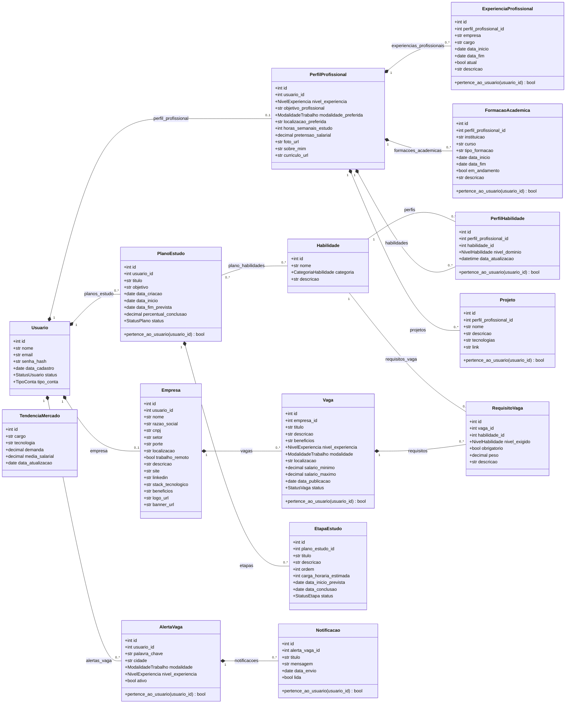

# Diagrama de Classes

Diagrama das classes de domínio do Market Skills, feito a partir dos
Models em `backend/models/`. Cada classe corresponde a uma tabela do
banco MySQL (nome da tabela entre parênteses na lista abaixo do diagrama).

## Classes e tabelas

| Classe | Tabela | Arquivo |
|---|---|---|
| Usuario | `usuarios` | `models/usuario.py` |
| PerfilProfissional | `perfis_profissionais` | `models/perfil_profissional.py` |
| Habilidade | `habilidades` | `models/habilidade.py` |
| PerfilHabilidade | `perfil_habilidades` | `models/perfil_habilidade.py` |
| ExperienciaProfissional | `experiencias_profissionais` | `models/experiencia_profissional.py` |
| FormacaoAcademica | `formacoes_academicas` | `models/formacao_academica.py` |
| Projeto | `projetos` | `models/projeto.py` |
| Empresa | `empresas` | `models/empresa.py` |
| Vaga | `vagas` | `models/vaga.py` |
| RequisitoVaga | `requisitos_vaga` | `models/requisito_vaga.py` |
| PlanoEstudo | `planos_estudo` | `models/plano_estudo.py` |
| EtapaEstudo | `etapas_estudo` | `models/etapa_estudo.py` |
| AlertaVaga | `alertas_vaga` | `models/alerta_vaga.py` |
| Notificacao | `notificacoes` | `models/notificacao.py` |
| TendenciaMercado | `tendencias_mercado` | `models/tendencia_mercado.py` |
| (associação PlanoEstudo–Habilidade) | `plano_habilidades` | `models/plano_estudo.py` |

## Como ler o diagrama

- **Composição (`*--`)**: o objeto "parte" não existe sem o "todo".
  No código, a relação tem `cascade="all, delete-orphan"` e a chave
  estrangeira é obrigatória. Exemplo: ao excluir uma `Vaga`, os seus
  `RequisitoVaga` também são excluídos.
- **Associação (`--`)**: as duas classes existem de forma independente.
  Exemplo: uma `Habilidade` do catálogo é usada por vários requisitos
  de vagas e por vários perfis.
- **`0..1`**: `perfis_profissionais.usuario_id` e `empresas.usuario_id`
  são únicos, então cada usuário tem no máximo um perfil profissional
  (conta estudante) ou uma empresa (conta empresa).
- **`PerfilHabilidade`** é a classe de associação entre
  `PerfilProfissional` e `Habilidade`: guarda o nível de domínio e
  tem restrição de unicidade no par (perfil, habilidade). As duas
  chaves estrangeiras têm `ondelete="CASCADE"`, então o vínculo é
  removido se o perfil ou a habilidade for excluído.
- **`plano_habilidades`** é uma tabela associativa simples
  (muitos-para-muitos), sem atributos próprios.
- **`TendenciaMercado`** é um catálogo independente, sem chaves
  estrangeiras.
- Não há herança entre as classes de domínio: todas apenas estendem
  `db.Model` (classe base do Flask-SQLAlchemy).

## Enumerações

| Enum | Valores |
|---|---|
| StatusUsuario | `ativo`, `inativo` |
| TipoConta | `estudante`, `empresa` |
| NivelExperiencia | `iniciante`, `junior`, `pleno`, `senior` |
| ModalidadeTrabalho | `presencial`, `hibrido`, `remoto` |
| CategoriaHabilidade | `linguagem`, `framework`, `banco_dados`, `ferramenta`, `conceito`, `outra` |
| NivelHabilidade | `basico`, `intermediario`, `avancado` |
| StatusVaga | `ativa`, `pausada`, `encerrada` |
| StatusPlano | `nao_iniciado`, `em_andamento`, `pausado`, `concluido` |
| StatusEtapa | `pendente`, `em_andamento`, `concluida` |

## Métodos comuns

Além de `pertence_ao_usuario()` (indicado no diagrama nas classes que o
possuem, usado nas regras de autorização dos Services), todos os Models
têm os mesmos métodos de persistência: `salvar()`, `atualizar()`,
`deletar()`, `listar_todos()`, `buscar_por_id()` e `to_dict()`.
