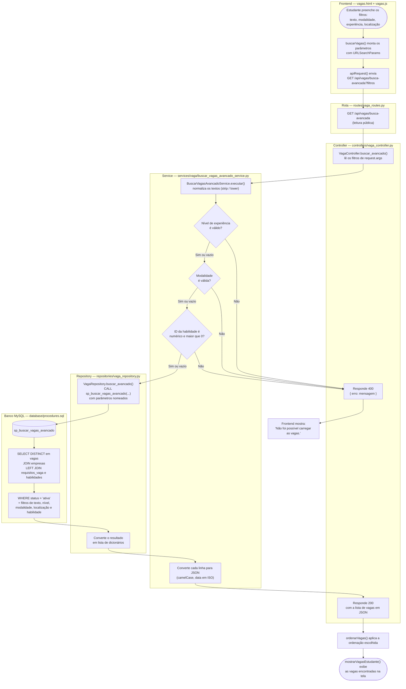

# Fluxograma — Buscar vagas com filtros avançados

**Tipo:** recuperação de dados
**Caso de uso:** o estudante pesquisa vagas por texto, nível de experiência,
modalidade e localização, e recebe apenas as vagas ativas que atendem aos filtros.

**Caminho pelas camadas:**
Frontend → Rota → Controller → Service → Repository → Stored Procedure (MySQL) → resposta

## Responsabilidade de cada camada

| Camada | Arquivo | O que faz neste caso de uso |
|---|---|---|
| Frontend | `frontend/assets/js/vagas.js` | Lê os filtros da tela, chama a API e exibe o resultado |
| Rota | `backend/routes/vaga_routes.py` | Liga `GET /api/vagas/busca-avancada` ao Controller |
| Controller | `backend/controllers/vaga_controller.py` | Recebe a requisição, aciona o Service e devolve 200 ou 400 |
| Service | `backend/services/vaga/buscar_vagas_avancado_service.py` | Regras do caso de uso: valida nível, modalidade e habilidade; formata a resposta |
| Repository | `backend/repositories/vaga_repository.py` | Executa a consulta SQL (`CALL` da Stored Procedure) |
| Banco | `backend/database/procedures.sql` | `sp_buscar_vagas_avancado`: filtra só vagas ativas com JOIN entre vagas, empresas, requisitos e habilidades |
