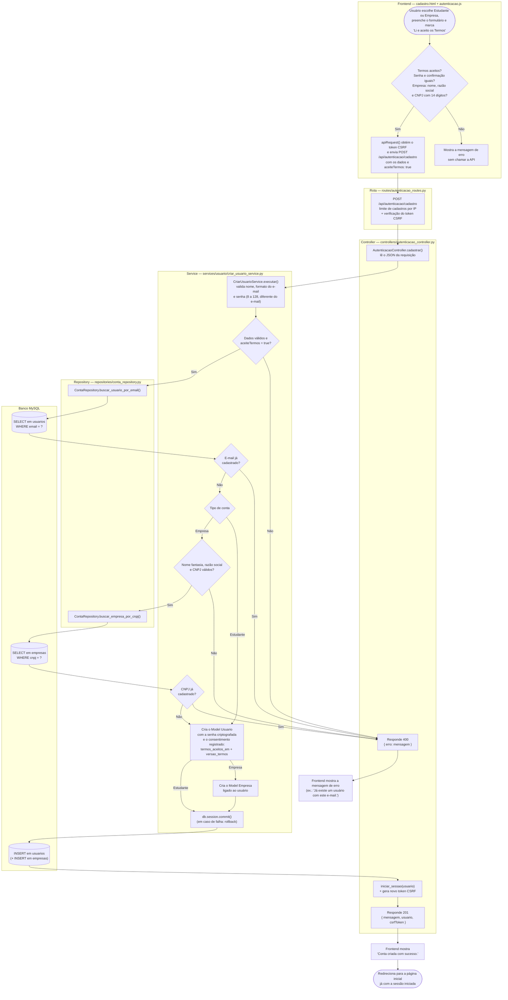

# Fluxograma — Cadastrar usuário (estudante ou empresa)

**Tipo:** entrada de dados
**Caso de uso:** uma pessoa cria uma conta de estudante ou de empresa. Ela precisa
aceitar os Termos de Uso e a Política de Privacidade; os dados são validados, o
sistema confere se o e-mail (e o CNPJ, no caso de empresa) ainda não existe e grava
a conta no banco junto com a data e a versão do aceite.

**Caminho pelas camadas:**
Frontend → Rota → Controller → Service → Repository → Models → MySQL → resposta

## Responsabilidade de cada camada

| Camada | Arquivo | O que faz neste caso de uso |
|---|---|---|
| Frontend | `frontend/assets/js/autenticacao.js` | Validação rápida no navegador, envio dos dados com token CSRF e redirecionamento |
| Rota | `backend/routes/autenticacao_routes.py` | Liga `POST /api/autenticacao/cadastro` ao Controller, com limite de requisições por IP |
| Controller | `backend/controllers/autenticacao_controller.py` | Recebe a requisição, aciona o Service, inicia a sessão e devolve 201 ou 400 |
| Service | `backend/services/usuario/criar_usuario_service.py` | Regras do caso de uso: exige o aceite dos termos, valida os dados, impede e-mail ou CNPJ repetido, criptografa a senha e grava a conta com a data e a versão do aceite |
| Repository | `backend/repositories/conta_repository.py` | Consultas ao banco: busca usuário por e-mail e empresa por CNPJ |
| Models | `backend/models/usuario.py`, `backend/models/empresa.py` | Representam as tabelas `usuarios` e `empresas` (ORM SQLAlchemy) |
| Banco | MySQL | Tabelas `usuarios` e `empresas` |
